<h1 align="center">Cobble</h1>

<p align="center">
  <b>Décrivez une idée. Des agents peu coûteux la construisent. La CI arbitre. Vous validez une démo.</b><br>
  <i>Describe an idea. Inexpensive agents build it. CI is the referee. You approve a demo.</i>
</p>

<p align="center">
  <a href="https://github.com/Installation-04/Cobble/actions"></a>
  
  
</p>

<p align="center">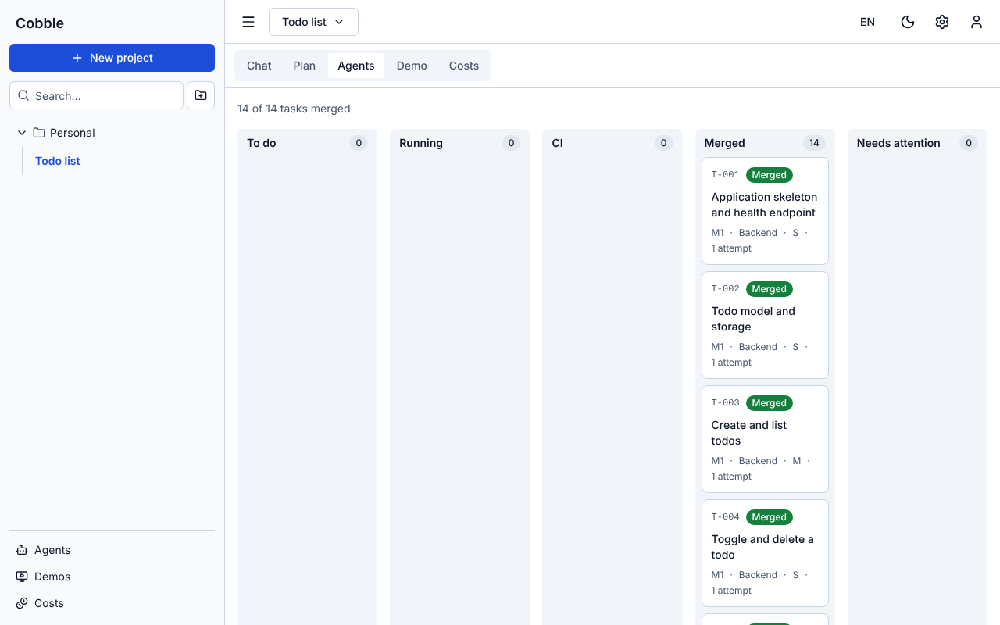</p>

**Français** · [English](#english)

---

## Qu'est-ce que Cobble ?

Cobble est une plateforme **libre et auto-hébergée** qui transforme une idée en application fonctionnelle, au coût le plus bas possible.

1. **Vous décrivez votre idée dans un chat.** Un modèle fort (le *planner*) pose des questions ciblées, rédige une spec et la découpe en un plan de tâches petites et testables.
2. **Vous approuvez le plan et son estimation de coût** avant que le moindre code ne soit écrit.
3. **Des agents peu coûteux codent**, un conteneur isolé par tâche, *tests d'abord*: un agent écrit les tests, un autre implémente jusqu'à ce qu'ils passent.
4. **La CI arbitre**: une tâche n'est « finie » que si la CI est verte; sinon la fusion est refusée.
5. **Vous validez une démo à chaque jalon**: vous la validez, la commentez (le commentaire devient une tâche) ou revenez au jalon précédent.

Tout passe par une passerelle de modèles (LiteLLM) et un **routeur de coûts** avec un budget par projet et un plafond dur: le coût est affiché partout, en dollars et en jetons.

> **État**: v0.1, candidate à la version (*release candidate*). Le code est complet et la CI est verte, mais **la validation réelle sur une machine vierge avec une vraie clé d'API n'a pas encore été faite**. Voir [`docs/releases/v0.1.md`](docs/releases/v0.1.md). Les captures ci-dessous sont prises avec le faux fournisseur de modèles et le « faux pack » de développement: la démo affichée est factice.

## Le parcours en images

| | |
|---|---|
| 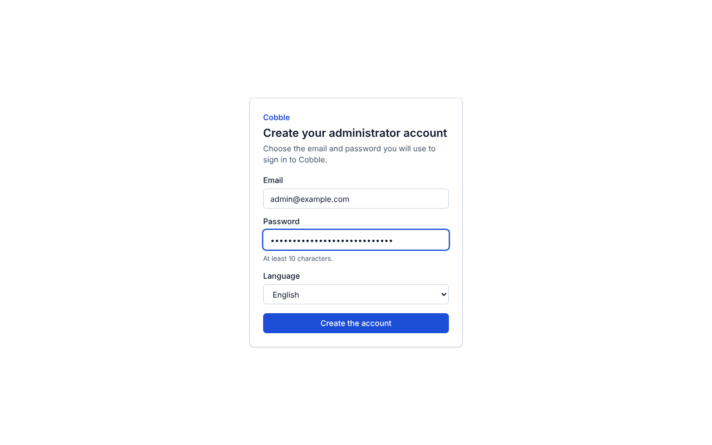 **1. Activation** — le compte admin se crée avec un lien à usage unique. | 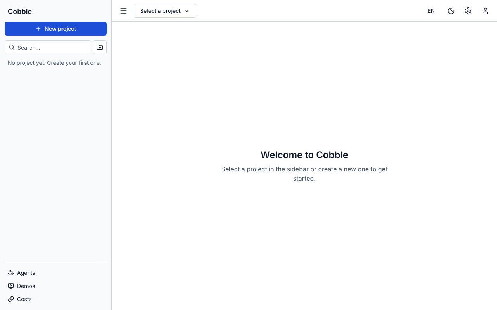 **2. Projets en dossiers**, FR/EN, clair/sombre. |
| 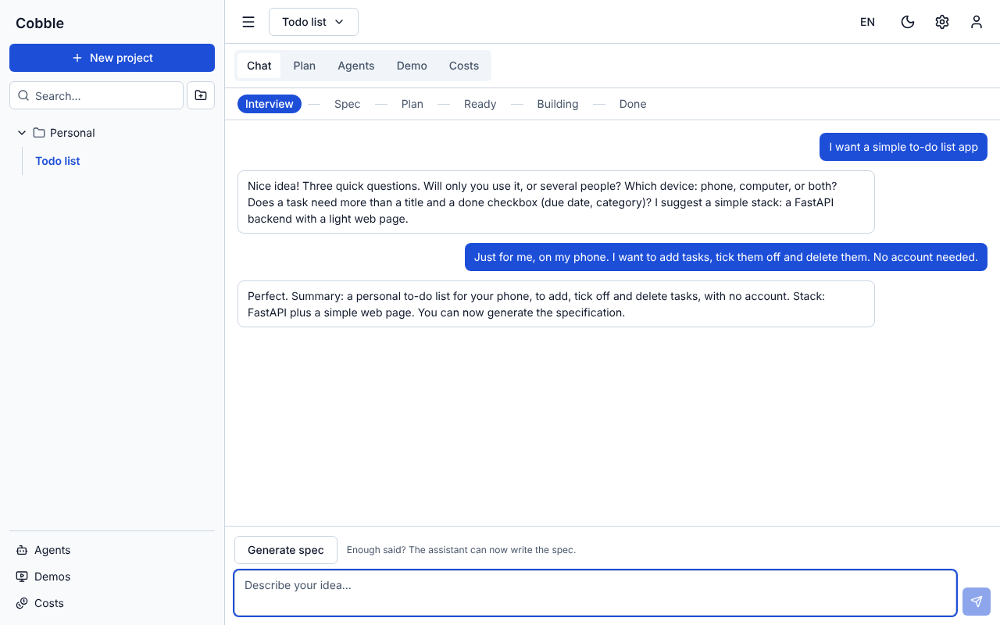 **3. Entrevue** — le planner pose des questions et répond dans votre langue. | 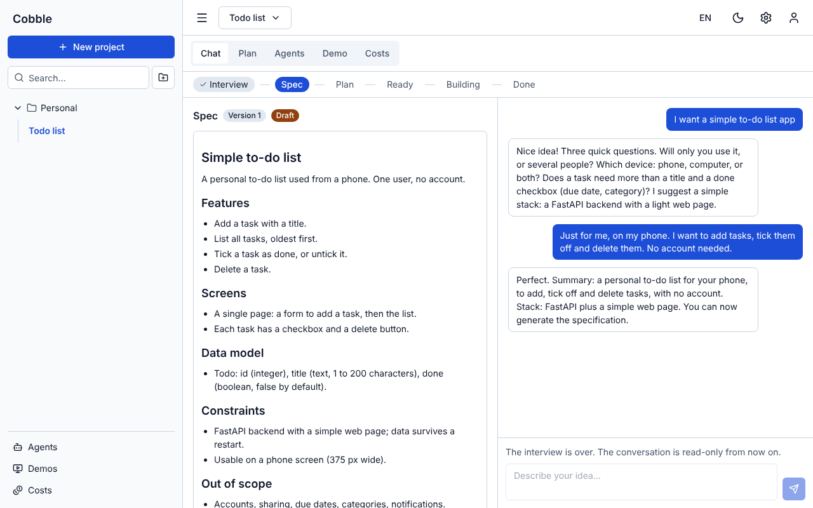 **4. Spec** — à approuver ou à faire corriger. |
| 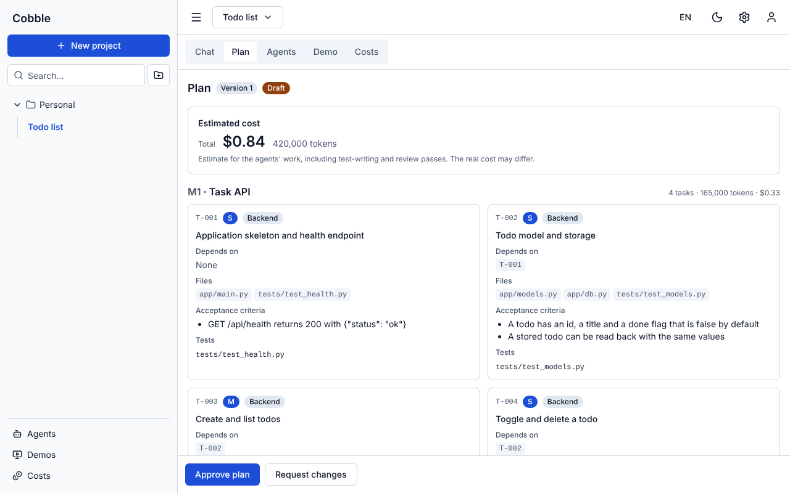 **5. Plan** — tâches avec dépendances, fichiers, critères d'acceptation et estimation. | 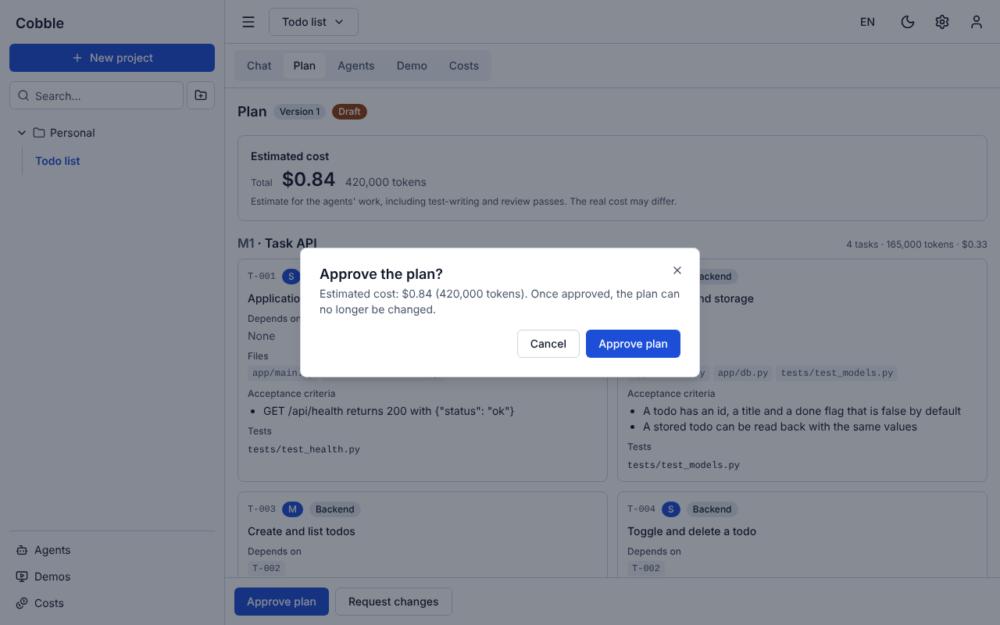 **6. Coût annoncé** avant le lancement. |
|  **7. Agents** — tâches par état, une par conteneur. | 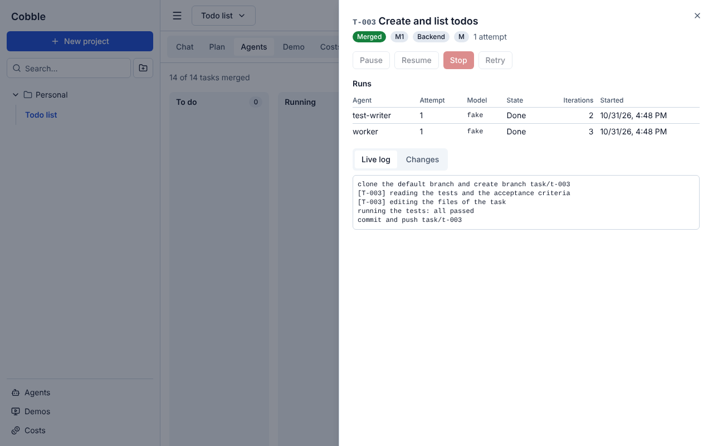 **8. Journal en direct** de chaque tâche. |
| 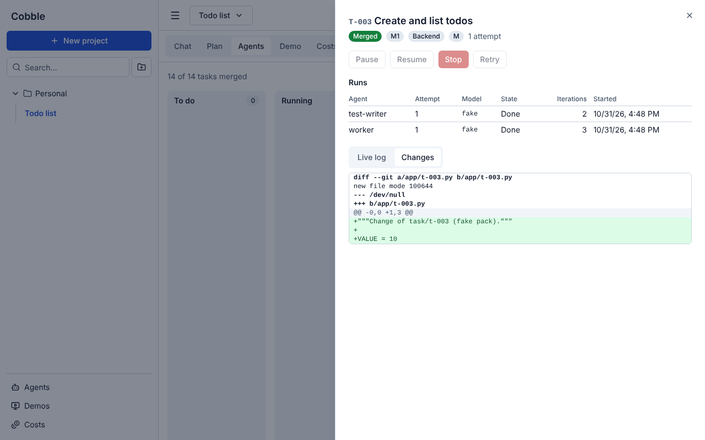 **9. Diff** de la tâche. | 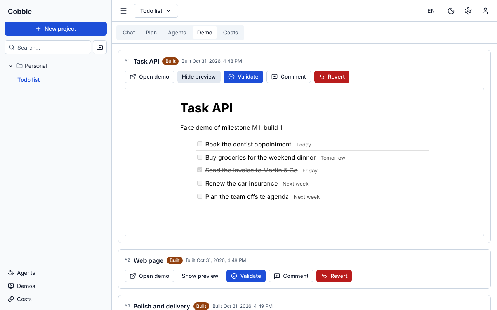 **10. Démo par jalon** — valider, commenter, revenir. |
| 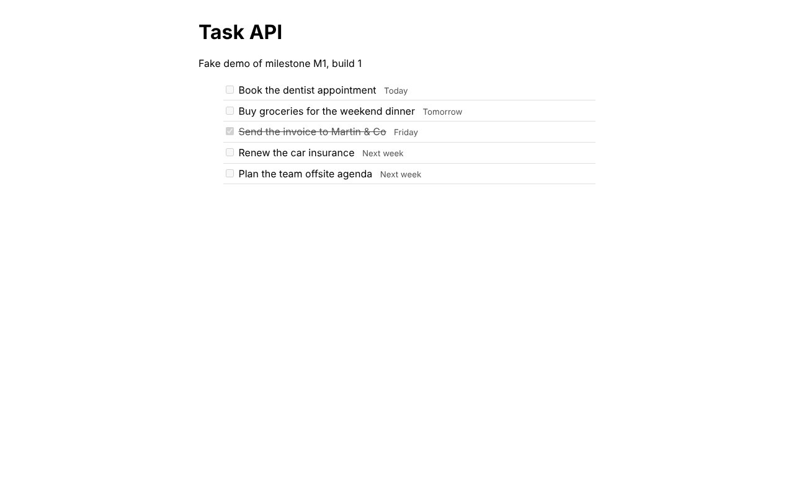 **11. L'application générée**, avec des données réalistes. | 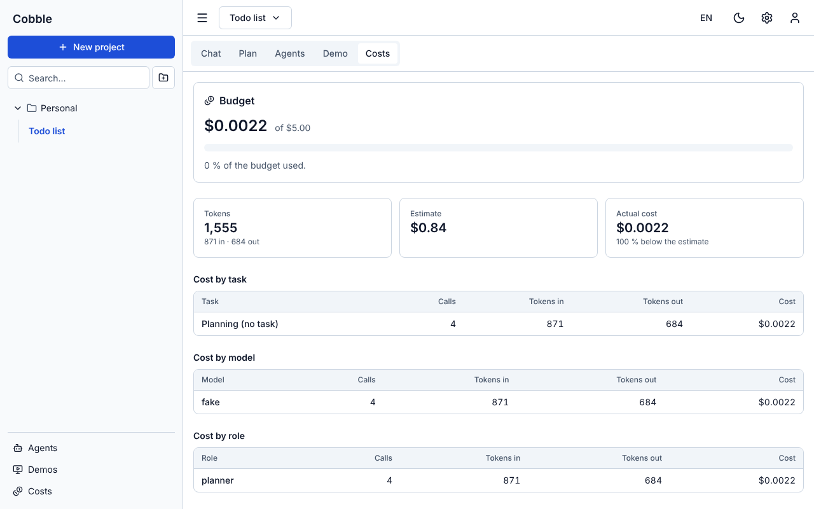 **12. Coûts** par tâche, modèle et rôle. |
| 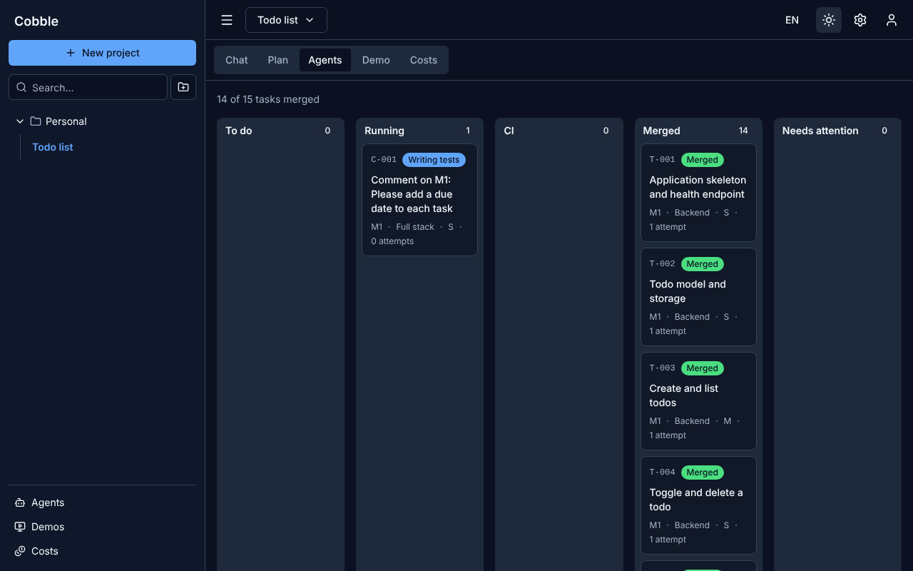 **Mode sombre** par jetons de thème. | 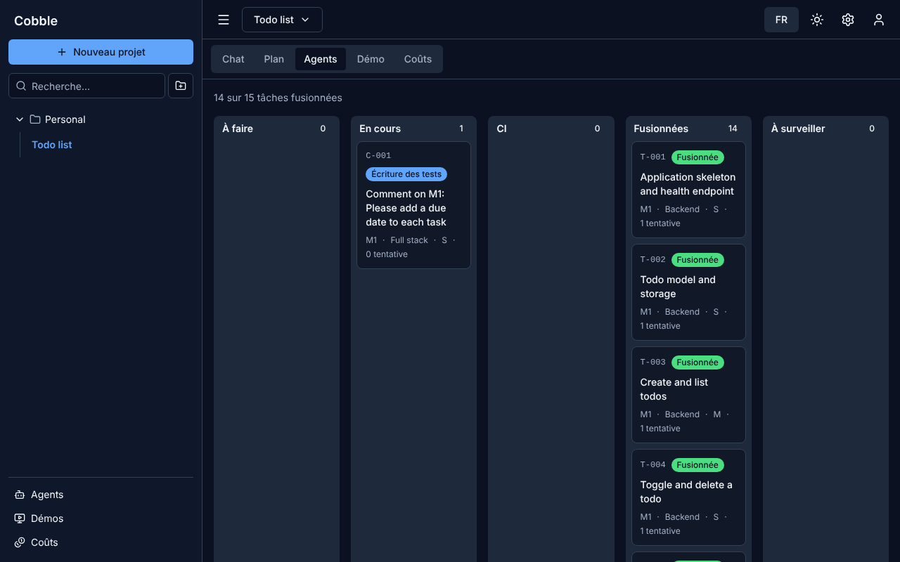 **Interface bilingue** FR/EN. |

## Démarrer

### Essayer en local (aucune clé d'API requise)

```bash
make install
make dev                # lance tout avec un faux fournisseur de modèles
make activation-link    # lien à usage unique pour créer le compte admin
```

Ouvrir `http://localhost:8080`. Voir [`docs/fr/dev.md`](docs/fr/dev.md).

### Installer sur un serveur (Ubuntu 24.04/26.04, Debian 12/13)

```bash
curl -fsSL <URL de install.sh> | sudo bash
```

Le script installe Docker (dépôt officiel), le noyau dans `/opt/cobble`, un service systemd et la CLI `cobble`, puis affiche le lien d'activation. Il est idempotent. Voir [`docs/fr/install.md`](docs/fr/install.md). `cobble status | logs | update | doctor | reset-admin | uninstall`.

## Comment c'est construit

```
 Navigateur ──HTTP──▶ Caddy ──▶ UI (React) · API (FastAPI) ──▶ Postgres · Redis
                                          │
                  worker ─▶ planner · ordonnanceur ─▶ routeur de coûts ─▶ LiteLLM ─▶ modèles
                                          │
        service de pack (seul à toucher Docker) ─▶ agents Aider isolés · Forgejo · Woodpecker · aperçus
```

- **Capacités, pas produits**: le noyau parle à `GitProvider`, `CIProvider`, `AgentRunner` et `LLMClient`; Forgejo, Woodpecker et Aider sont le *pack fixe* de la v0.1.
- **Sécurité des agents**: conteneurs non-root, sans socket Docker, limites CPU/RAM/PID/durée, système de fichiers en lecture seule, réseau sans sortie sauf un proxy à liste blanche; aucun jeton Git dans le conteneur; les appels de modèle passent par le routeur de coûts avec un jeton signé par exécution.
- **Reproductible**: images Docker épinglées par digest, dépendances verrouillées, interface et messages entièrement bilingues.

## Commandes utiles

| Commande | Rôle |
|---|---|
| `make dev` / `make dev-down` | lancer / arrêter le noyau en local |
| `make lint test` | contrôles et tests unitaires (backend, UI, installateur) |
| `make test-integration` | tests avec Postgres, Redis et LiteLLM réels |
| `make e2e` | tests navigateur (Playwright) de tout le parcours, en « faux pack » |
| `make screenshots` | régénère les captures de `docs/images/` |
| `make e2e-full` | chaîne réelle complète (manuel, long) |

## Limites de la v0.1

HTTP seulement (pas de HTTPS automatique), amd64 seulement, pas de GPU/Ollama dans le pack (API de modèles seulement), pas de `backup`/`restore`, une seule instance de worker. La chaîne réelle complète (Forgejo + Woodpecker + Aider + aperçus) a été vérifiée par morceaux mais pas encore d'un bout à l'autre.

## Documentation

[Wiki et guides (`docs/wiki`)](docs/wiki/Home.md) · [Installation](docs/fr/install.md) · [Développement](docs/fr/dev.md) · [Pack](docs/fr/pack.md) · [Agents](docs/fr/agents.md) · [Démos](docs/fr/demo.md) · [Décisions d'architecture](docs/decisions/) · [Plan complet](PLAN.md) · [Notes de version](docs/releases/v0.1.md)

## Contribuer, sécurité, licence

[CONTRIBUTING.md](CONTRIBUTING.md) (commits signés DCO) · [SECURITY.md](SECURITY.md) · [CODE_OF_CONDUCT.md](CODE_OF_CONDUCT.md). Noyau sous **AGPL-3.0**; le gabarit de projet (`templates/`) est sous **Apache-2.0**: les applications générées vous appartiennent.

---

## English

### What is Cobble?

Cobble is a **free, self-hosted platform** that turns an idea into a working application at the lowest possible cost.

1. **You describe your idea in a chat.** A strong model (the *planner*) asks targeted questions, writes a spec and splits it into a plan of small, testable tasks.
2. **You approve the plan and its cost estimate** before any code is written.
3. **Inexpensive agents write the code**, one isolated container per task, *tests first*: one agent writes the tests, another implements until they pass.
4. **CI is the referee**: a task is only "done" when CI is green; otherwise the merge is refused.
5. **You approve a demo at each milestone**: validate it, comment on it (the comment becomes a task) or go back to the previous milestone.

Every model call goes through a model gateway (LiteLLM) and a **cost router** with a per-project budget and a hard cap: cost is shown everywhere, in dollars and tokens.

> **Status**: v0.1 **release candidate**. The code is complete and CI is green, but **real validation on a clean machine with a real API key has not been done yet**. See [`docs/releases/v0.1.md`](docs/releases/v0.1.md). The screenshots above use the fake model provider and the development "fake pack": the demo shown is fictional.

### Quick start

```bash
make install
make dev                # starts everything with a fake model provider (no API key)
make activation-link    # one-use link to create the admin account
```

Open `http://localhost:8080`. See [`docs/en/dev.md`](docs/en/dev.md). To install on a server (Ubuntu 24.04/26.04, Debian 12/13): `curl -fsSL <install.sh URL> | sudo bash`, see [`docs/en/install.md`](docs/en/install.md).

### How it is built

The core talks to **capabilities** (`GitProvider`, `CIProvider`, `AgentRunner`, `LLMClient`), never to a product: Forgejo, Woodpecker and Aider are the fixed v0.1 pack. Agents run in locked-down containers (non-root, no Docker socket, resource limits, read-only root, egress only through an allowlist proxy, no Git credentials inside, model calls through the cost router with a signed per-run token). Docker images are pinned by digest, dependencies are locked, and the UI and messages are fully bilingual (FR/EN).

### Limits of v0.1

Plain HTTP only, amd64 only, no GPU/Ollama in the pack (hosted model APIs only), no `backup`/`restore`, a single worker instance. The full real chain (Forgejo + Woodpecker + Aider + previews) was verified in pieces but not yet end to end.

### Documentation, contributing, license

[Wiki and guides (`docs/wiki`)](docs/wiki/Home.md) · [Architecture decisions](docs/decisions/) · [Full plan (French)](PLAN.md) · [Release notes](docs/releases/v0.1.md) · [CONTRIBUTING.md](CONTRIBUTING.md) · [SECURITY.md](SECURITY.md). Core under **AGPL-3.0**; the project template (`templates/`) is **Apache-2.0**: generated applications belong to you.
